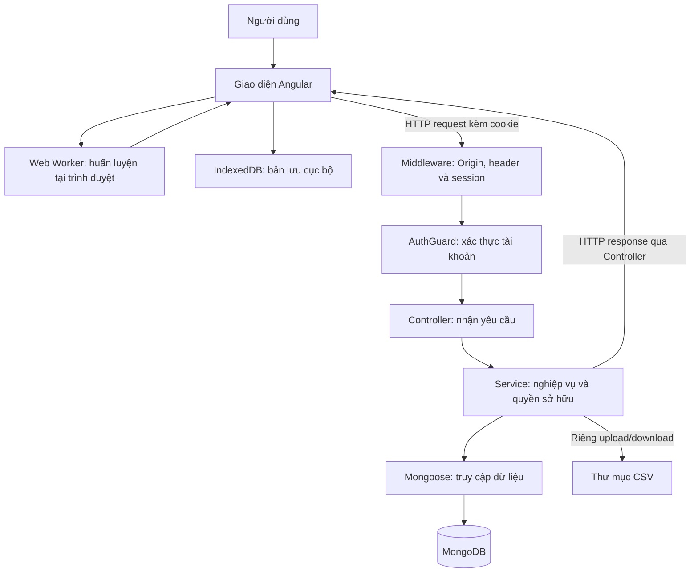
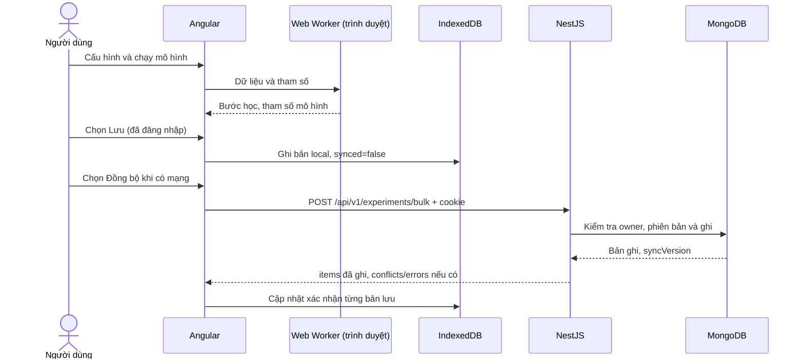

# THIẾT KẾ VÀ XÂY DỰNG API CHO HỆ THỐNG HỒI QUY 3D

> Bản thảo cho phần thiết kế và triển khai hệ thống trong tiểu luận, đối chiếu mã nguồn ngày 14/11/2026. Có thể đổi số mục theo chương của báo cáo chính. Ví dụ JSON là dữ liệu minh họa, không phải kết quả thực nghiệm.

## 1. Mục đích và phạm vi

Hệ thống Hồi quy 3D cho phép người học chuẩn bị dữ liệu, lựa chọn thuật toán, quan sát quá trình học và lưu kết quả. API (Application Programming Interface — giao diện lập trình ứng dụng) tiếp nhận yêu cầu từ giao diện, xử lý nghiệp vụ và truy cập dữ liệu trên máy chủ. Ví dụ, khi người dùng chọn đồng bộ thí nghiệm, giao diện gửi cấu hình và kết quả qua API để lưu vào MongoDB.

Backend được xây dựng bằng NestJS và TypeScript, sử dụng Mongoose để truy cập MongoDB. API gồm sáu nhóm nghiệp vụ: xác thực, tài khoản cá nhân, bộ dữ liệu, thí nghiệm, bản ghi lần huấn luyện và đồng bộ. Ngoài ra có hai API kiểm tra hoạt động cơ bản.

| Thành phần | Trách nhiệm thực tế | Ví dụ |
| --- | --- | --- |
| Angular | Nhận thao tác, chuẩn bị dữ liệu, quản lý trạng thái | Chọn cột đầu vào và cột mục tiêu |
| Web Worker trong trình duyệt | Tính toán các bước huấn luyện | Cập nhật trọng số sau mỗi bước học |
| Three.js | Trực quan hóa dữ liệu và mô hình | Vẽ mặt hồi quy trong không gian 3D |
| IndexedDB trong trình duyệt | Lưu thí nghiệm cục bộ theo tài khoản | Giữ bản lưu đang chờ đồng bộ |
| NestJS | Xác thực, kiểm tra quyền, lưu và đồng bộ | Ghi kết quả frontend gửi lên |
| MongoDB và thư mục tệp | Lưu bản ghi và tệp CSV tải lên | MongoDB giữ metadata, ổ đĩa giữ tệp gốc |

Web Worker là luồng xử lý phụ trong trình duyệt, giúp tính toán mà hạn chế làm đứng giao diện. Worker không phải backend. API hiện không có chức năng trực tiếp bắt đầu, dừng huấn luyện hoặc tính dự đoán; các thao tác này được xử lý ở frontend.

## 2. Kiến trúc và cấu trúc mã nguồn

### 2.1. Luồng xử lý yêu cầu



**Hình 1.** Quan hệ giữa xử lý cục bộ và API máy chủ. Nhánh IndexedDB không đồng nghĩa dữ liệu đã được ghi vào MongoDB. Trong triển khai Docker, yêu cầu còn đi qua Nginx trước khi tới NestJS.

Middleware kiểm tra nguồn gửi và header, sau đó đọc phiên. AuthGuard kiểm tra tài khoản; Controller tiếp nhận tham số; Service kiểm tra nghiệp vụ và quyền sở hữu; Mongoose thực hiện đọc/ghi; kết quả được trả về frontend. ValidationPipe kiểm tra DTO hiện được gắn riêng cho nhóm xác thực và tài khoản, chưa áp dụng thống nhất cho mọi controller.

### 2.2. Tổ chức thư mục

```text
D:\JS,TS/
├── src/
│   ├── main.ts                    Khởi động server
│   ├── app.module.ts              Đăng ký module hoạt động
│   ├── app.controller.ts          API gốc và health
│   ├── common/                    Session, guard, quyền, CSV, phân trang
│   ├── login/                     API /auth và nhật ký xác thực
│   ├── users/                     Tài khoản cá nhân
│   ├── datasets/                  Metadata và tệp CSV
│   ├── experiments/               Cấu hình, kết quả và lưu theo lô
│   ├── training-runs/             Bản ghi từng lần huấn luyện
│   └── sync/                      Đồng bộ thao tác và lấy thay đổi
├── FE/FE-hoiquy3d/src/app/
│   ├── core/engine/               Tính toán và Web Worker
│   ├── core/storage/              IndexedDB
│   └── state/                     Phiên, thí nghiệm và đồng bộ
├── database/backend/              Bộ model độc lập, không phải REST server
├── deploy/nginx.conf              Chuyển tiếp API qua HTTPS
├── test/app.e2e-spec.ts            Kiểm thử API với MongoDB tạm
└── docs/                          Tài liệu và báo cáo
```

| Thành phần | Vai trò | Ví dụ |
| --- | --- | --- |
| Module | Gom thành phần theo chức năng | `ExperimentsModule` |
| Controller | Khai báo phương thức HTTP và đường dẫn | `ExperimentsController.bulkUpsert()` |
| Service | Xử lý nghiệp vụ, điều phối lưu trữ | `ExperimentsService.bulkUpsert()` |
| DTO | Mô tả dữ liệu truyền vào | `CreateExperimentDto` |
| Schema | Khai báo cấu trúc, kiểu và ràng buộc dữ liệu | `ExperimentSchema` |
| Guard | Kiểm tra điều kiện truy cập | `AuthGuard` |

DTO (Data Transfer Object) là đối tượng mô tả dữ liệu trao đổi. Ví dụ, `LoginDto` có email và mật khẩu. Kiểu TypeScript trong DTO không tự kiểm tra dữ liệu HTTP khi chạy; cần kết hợp validation hoặc logic Service. Schema mô tả dữ liệu lưu, ví dụ tên thí nghiệm tối đa 120 ký tự.

## 3. Quy ước giao tiếp và quyền truy cập

### 3.1. Địa chỉ, dữ liệu và HTTP

Địa chỉ cơ sở khi chạy trực tiếp backend là `http://localhost:3000/api/v1`. Tiền tố `/api/v1` phân biệt nhóm API và phiên bản giao diện. Các đường dẫn bên dưới viết sau tiền tố này.

| Nội dung | Quy ước hiện tại |
| --- | --- |
| Giao tiếp | HTTP khi phát triển; HTTPS qua Nginx khi triển khai |
| Body thông thường | JSON, gửi `Content-Type: application/json` |
| Upload | `multipart/form-data`, trường tệp `file`; trình duyệt tự đặt boundary |
| Download | Nội dung tệp đính kèm; frontend đọc Blob, không đọc JSON |
| Phiên | Cookie `hq3d.sid`; frontend gửi `credentials: 'include'` |
| Thao tác ghi | POST/PATCH/PUT/DELETE cần `X-Requested-With: XMLHttpRequest` |
| Body JSON | Tối đa 10 MiB |
| Phân trang | Mặc định `page=1`, `limit=20`; số nguyên dương; limit tối đa 100 |
| Thời gian | Trường Date trả chuỗi ISO 8601; `clientCreatedAt` là số thời gian phía client |

Endpoint là tổ hợp phương thức HTTP và đường dẫn. Ví dụ, `GET /experiments` lấy danh sách, còn `POST /experiments` tạo thí nghiệm. API chủ yếu tổ chức theo tài nguyên, có thêm đường dẫn hành động như `/login`, `/bulk`, `/upload`. Báo cáo giữ đúng hợp đồng hiện có; không đổi phương thức HTTP chỉ để bảng trình bày giống một thiết kế dự kiến.

### 3.2. Xác thực và phân quyền

Luồng hiện tại dùng session phía máy chủ, không dùng JWT. Đăng nhập thành công tạo lại phiên và gắn mã tài khoản vào session. Cookie có `HttpOnly`, `SameSite=Lax`, thời hạn cấu hình 7 ngày; bật `Secure` ở production hoặc khi `COOKIE_SECURE=true`. Phiên lưu trong collection `sessions` ở môi trường thông thường; test dùng bộ nhớ.

`HttpOnly` ngăn JavaScript đọc trực tiếp cookie; `Secure` yêu cầu truyền cookie qua HTTPS. Frontend không cần đọc mã phiên để gắn vào body: trình duyệt gửi cookie theo cấu hình credentials.

| Đối tượng | Phạm vi quyền |
| --- | --- |
| Chưa đăng nhập | API gốc, health, đăng ký, đăng nhập |
| Người dùng đăng nhập | Tài khoản cá nhân và dữ liệu thuộc sở hữu của mình |
| Role `admin` | Bỏ lọc owner trên API tài nguyên dùng `ownerFilter`; API tài khoản cá nhân vẫn thao tác chính tài khoản đang đăng nhập |

`ownerId` lấy từ phiên, không tin giá trị client tự gửi. Tài nguyên không tồn tại hoặc thuộc tài khoản khác thường trả `404`. AuthGuard đọc lại tài khoản mỗi yêu cầu, kiểm tra trạng thái `active` và `sessionVersion`; phiên không hợp lệ trả `401`.

Controller hiện không có API quản trị danh sách người dùng, sửa quyền hoặc xóa tài khoản khác. Role `admin` phục vụ quyền trên tài nguyên; guard role cũ không dùng đã được xóa.

### 3.3. Định danh và response

`_id` là khóa MongoDB; `clientId` là mã chuỗi ổn định để đối chiếu bản ghi trình duyệt. Dataset, experiment, training run nhận `_id` hoặc `clientId` khi tìm theo ID. Trong bulk, trường `id` là alias của `clientId`, không phải `_id`. `clientId` có ràng buộc duy nhất trên từng collection.

API danh sách datasets, experiments và training runs dùng cấu trúc sau. Các API chi tiết thường trả trực tiếp đối tượng, không có lớp bọc `data` dùng chung.

```json
{ "items": [], "total": 0, "page": 1, "limit": 20, "totalPages": 0 }
```

`totalPages = ceil(total/limit)`. Các trường tham chiếu như `datasetId` có thể trả thành đối tượng khi Service dùng `populate` để lấy bản ghi liên quan.

## 4. Danh mục chức năng API

Bảy controller được đăng ký hiện cung cấp **27 endpoint**, gồm 2 endpoint hệ thống và 25 endpoint nghiệp vụ. “Có phiên” nghĩa là tài khoản hoạt động và cookie phiên hợp lệ. Mã HTTP trong bảng là mã thành công của handler.

### 4.1. Kiểm tra hoạt động — 2 endpoint

| HTTP | Đường dẫn | Chức năng/kết quả | Quyền | Mã |
| --- | --- | --- | --- | --- |
| GET | `/` | Trả chuỗi `Hello World!` | Công khai | 200 |
| GET | `/health` | Trả status, service, version, timestamp | Công khai | 200 |

Health chỉ phản ánh handler hoạt động; chưa truy vấn MongoDB hay kiểm tra thư mục tệp. Giá trị version được khai báo trực tiếp trong controller.

### 4.2. Xác thực — 4 endpoint

| HTTP | Đường dẫn | Đầu vào | Chức năng/kết quả | Quyền | Mã |
| --- | --- | --- | --- | --- | --- |
| POST | `/auth/register` | email, password, displayName | Tạo tài khoản, trả thông tin công khai; chưa đăng nhập | Công khai | 201 |
| POST | `/auth/login` | email, password | Kiểm tra mật khẩu, tạo phiên, trả tài khoản và cookie | Công khai | 200 |
| POST | `/auth/logout` | Cookie | Hủy phiên, xóa cookie; trả success=true | Có phiên | 200 |
| GET | `/auth/me` | Cookie | Lấy tài khoản gắn với phiên hiện tại | Có phiên | 200 |

Email được trim và chuyển chữ thường. Mật khẩu yêu cầu 8–72 ký tự, đồng thời tối đa 72 byte UTF-8 để phù hợp bcrypt. Tên hiển thị dài 1–120 ký tự sau trim. Đăng ký luôn tạo role `user`; role/ownerId tự gửi bị bỏ qua. Đăng ký và đăng nhập có giới hạn 5 yêu cầu mỗi 60 giây theo bộ giới hạn của ứng dụng.

Mật khẩu được băm bằng bcrypt với cost 12. Băm là biến đổi một chiều, giúp kiểm tra mà không lưu mật khẩu gốc. Response tài khoản gồm `_id`, `email`, `displayName`, `role`, `status`, `createdAt`, `updatedAt`; không trả passwordHash hay sessionVersion.

### 4.3. Tài khoản cá nhân — 4 endpoint

| HTTP | Đường dẫn | Đầu vào | Chức năng/kết quả | Quyền | Mã |
| --- | --- | --- | --- | --- | --- |
| GET | `/users/me` | Cookie | Thông tin tài khoản, tương đương `/auth/me` | Chính mình | 200 |
| POST | `/users/me` | displayName | Cập nhật tên hiển thị, trả tài khoản | Chính mình | 200 |
| POST | `/users/me/password` | currentPassword, newPassword | Đổi mật khẩu, trả tài khoản | Chính mình | 200 |
| DELETE | `/users/me` | password | Xóa tài khoản, xóa mềm dữ liệu liên quan, hủy phiên | Chính mình | 200 |

Hai API cập nhật hiện dùng **POST**, không phải PATCH. Đổi mật khẩu tăng sessionVersion để vô hiệu hóa các phiên cũ; phiên đang thực hiện đổi được cập nhật để tiếp tục dùng. Xóa tài khoản yêu cầu đúng mật khẩu, đánh dấu xóa mềm datasets, experiments, training runs rồi xóa bản ghi tài khoản. Hệ thống chặn tự xóa admin hoạt động cuối cùng.

### 4.4. Bộ dữ liệu — 6 endpoint

| HTTP | Đường dẫn | Đầu vào | Chức năng/kết quả | Quyền | Mã |
| --- | --- | --- | --- | --- | --- |
| POST | `/datasets/upload` | Form: file, name tùy chọn | Kiểm tra CSV, lưu tệp và metadata | Có phiên, gắn owner | 201 |
| POST | `/datasets` | name, sourceType, metadata | Tạo bản ghi mô tả bộ dữ liệu | Có phiên, gắn owner | 201 |
| GET | `/datasets` | Query page, limit | Danh sách có phân trang | Owner/admin | 200 |
| GET | `/datasets/:id` | _id/clientId | Chi tiết bộ dữ liệu | Owner/admin | 200 |
| GET | `/datasets/:id/download` | _id/clientId | Tải tệp đã lưu trên máy chủ | Owner/admin | 200 |
| DELETE | `/datasets/:id` | _id/clientId | Xóa mềm; trả success, message | Owner/admin | 200 |

Metadata là thông tin mô tả, ví dụ tên tệp, số dòng và danh sách cột. `sourceType` nhận `upload`, `sample`, `generated`. Tạo metadata không tự tạo tệp; download chỉ thành công khi có tệp thực trên máy chủ.

Upload kiểm tra phần mở rộng `.csv`, MIME và cấu trúc CSV; giới hạn mặc định 10 MiB qua `MAX_DATASET_FILE_SIZE`. Backend thống kê cột, số dòng, dữ liệu xem trước và SHA-256; lưu tệp dưới tên UUID tại `DATASET_STORAGE_DIR` (mặc định `data/uploads`) và ghi metadata vào MongoDB. Nếu ghi metadata thất bại, tệp vừa tạo được dọn đi. Xóa mềm dataset đánh dấu `deletedAt`, không xóa ngay tệp vật lý.

SHA-256 là mã băm nội dung, hỗ trợ nhận diện tệp thay đổi. UUID là mã định danh chuỗi, giúp giảm khả năng trùng tên tệp.

### 4.5. Thí nghiệm — 6 endpoint

| HTTP | Đường dẫn | Đầu vào | Chức năng/kết quả | Quyền | Mã |
| --- | --- | --- | --- | --- | --- |
| POST | `/experiments` | datasetId, name, algorithm, targetColumn, featureColumns, cấu hình | Tạo thí nghiệm gắn dataset | Có phiên, gắn owner | 201 |
| POST | `/experiments/bulk` | Mảng tối đa 100 thí nghiệm | Tạo/cập nhật theo clientId, xác nhận từng mục | Owner/admin | 200 |
| GET | `/experiments` | Query page, limit | Danh sách và dataset liên quan | Owner/admin | 200 |
| GET | `/experiments/:id` | _id/clientId | Chi tiết cấu hình và kết quả | Owner/admin | 200 |
| PATCH | `/experiments/:id` | Các trường cập nhật | Cập nhật, tăng syncVersion; không đổi dataset | Owner/admin | 200 |
| DELETE | `/experiments/:id` | _id/clientId | Xóa mềm, tăng syncVersion | Owner/admin | 200 |

API tạo đơn yêu cầu dataset hợp lệ trong phạm vi truy cập, targetColumn không rỗng và ít nhất một featureColumn. Bulk cho phép bản lưu không gắn dataset riêng. Không áp điều kiện của tạo đơn cho mọi đường lưu.

Backend nhận năm giá trị thuật toán dưới đây. Đây là khả năng nhận/lưu cấu hình; frontend hiện có bốn thuật toán `linear`, `polynomial`, `ridge`, `lasso`.

| algorithm.type | Ý nghĩa | Kiểm tra tại validateAlgorithm khi được gọi |
| --- | --- | --- |
| linear | Hồi quy tuyến tính | solver: ordinary-least-squares hoặc gradient-descent; mặc định gradient-descent |
| polynomial | Hồi quy đa thức | degree nguyên 1–10 |
| ridge | Hồi quy có phạt L2 | lambda hữu hạn, không âm |
| lasso | Hồi quy có phạt L1 | lambda hữu hạn, không âm |
| neural-network | Cấu trúc cấu hình mạng nơ-ron ở backend | hiddenLayers là mảng số nguyên dương; chưa có giao diện huấn luyện tương ứng |

`degree` là bậc đa thức, ví dụ bậc 2 có thành phần bình phương. `lambda` điều chỉnh mức phạt trọng số. `learningRate` là tốc độ cập nhật trọng số mỗi bước; `seed` khởi tạo sinh số ngẫu nhiên, hỗ trợ tái lập dữ liệu khi giữ nguyên cấu hình.

`synthetic` mô tả dữ liệu tổng hợp: kind nhận linear/curved/correlated/sparse; version 1; sampleCount nguyên 2–1.000.000; featureCount nguyên 1–1.000; noise 0–50; seed số nguyên an toàn; trainRatio 0,5–0,95. Đây là giới hạn kiểm tra backend, không phải cam kết frontend chạy hiệu quả ở mọi kích thước đó.

### 4.6. Bản ghi lần huấn luyện — 3 endpoint

| HTTP | Đường dẫn | Đầu vào | Chức năng/kết quả | Quyền | Mã |
| --- | --- | --- | --- | --- | --- |
| POST | `/training-runs` | experimentId, algorithmType, configSnapshot, kết quả tùy chọn | Lưu một lần huấn luyện | Có phiên, kiểm tra experiment | 201 |
| GET | `/training-runs` | experimentId tùy chọn, page, limit | Danh sách, có thể lọc theo thí nghiệm | Owner/admin | 200 |
| GET | `/training-runs/:id` | _id/clientId | Chi tiết kết quả và experiment liên quan | Owner/admin | 200 |

Training run là bản ghi của một lần huấn luyện; một thí nghiệm có thể có nhiều bản ghi để so sánh cấu hình. Các trường lưu được gồm metrics, modelParameters, history, startedAt, completedAt. POST không khởi chạy thuật toán. Luồng frontend hiện lưu kết quả ngay trong experiment, chưa gọi nhóm training runs.

### 4.7. Đồng bộ tổng quát — 2 endpoint

| HTTP | Đường dẫn | Đầu vào | Chức năng/kết quả | Quyền | Mã |
| --- | --- | --- | --- | --- | --- |
| POST | `/sync/batch` | Đối tượng chứa mảng operations | Xử lý từng thao tác create/update/delete | Có phiên, kiểm tra owner/tham chiếu | 201 |
| GET | `/sync/changes` | Query since tùy chọn | Lấy thay đổi của ba nhóm tài nguyên, gồm bản xóa mềm | Owner/admin | 200 |

Mỗi operation có operationId, idempotencyKey, entityType, entityClientId, action, payload, clientVersion; có thể thêm clientUpdatedAt. entityType nhận experiment/dataset/trainingRun. Response gồm success, syncedAt, results; trạng thái từng mục là applied, duplicate, conflict hoặc error. HTTP thành công không đủ để kết luận cả lô đã thành công.

Idempotency là cơ chế nhận diện yêu cầu gửi lại để hạn chế áp dụng lặp. Ví dụ mất phản hồi, client gửi lại cùng idempotencyKey; backend trả duplicate nếu khóa đã ghi. Khóa được phân vùng theo tài khoản trước khi lưu. Thao tác đã sửa nội dung cần khóa mới.

Frontend hiện không gọi nhóm sync này trong luồng lưu thí nghiệm. Không dùng body `{operations:[...]}` để gọi bulk, vì `/experiments/bulk` nhận trực tiếp một mảng.

## 5. Cấu trúc dữ liệu và ý nghĩa kết quả

**Cập nhật quy trình học ngày 14/11/2026:** experiment có thêm `learningReport` tùy chọn, lưu protocol chia train/validation/test, validation metrics, thời gian tính toán/khởi tạo, lý do dừng, giả thuyết và nhận xét. Frontend dùng validation để thử siêu tham số, chỉ mở test theo lựa chọn đánh giá cuối; trường `test` trong bản kết quả đã lưu vẫn là test thực. CSV snapshot có thể chứa validationX/validationY. Bản cũ giữ nguyên cách chia đã lưu. Xem [chi tiết cải thiện quy trình học](CAI-TIEN-QUY-TRINH-HOC-2026-11-14.md). Các phép đo do client cung cấp, không phải benchmark hay kết quả backend xác minh.

| Collection | Trường tiêu biểu | Mục đích |
| --- | --- | --- |
| users | email, passwordHash, displayName, role, status, sessionVersion | Tài khoản |
| sessions | Dữ liệu phiên do connect-mongo quản lý | Duy trì đăng nhập ở môi trường thông thường |
| auditLogs | userId, action, targetId, ip, at | Nhật ký sự kiện tài khoản |
| datasets | clientId, name, columns, storage, ownerId | Metadata và tham chiếu tệp |
| experiments | clientId, algorithm, synthetic/csvData, w, b, train, test, syncVersion | Cấu hình và kết quả |
| trainingRuns | experimentId, configSnapshot, metrics, modelParameters, history | Lịch sử lần huấn luyện |
| syncOperations | operationId, idempotencyKey, entityType, action, status, ownerId | Nhật ký đồng bộ tổng quát |

Dataset có thể được nhiều experiment tham chiếu; experiment có thể có nhiều training run. Liên kết dùng ObjectId và kiểm tra ở Service, không phải khóa ngoại tự động của cơ sở dữ liệu quan hệ. Experiment lưu qua bulk có thể không gắn dataset.

Trong mô hình, `w` là trọng số, `b` là hệ số chệch. Ví dụ `w=[2,3]`, `b=1` biểu diễn hồi quy tuyến tính `ŷ = 2x₁ + 3x₂ + 1`. train/test chứa chỉ số của tập huấn luyện/kiểm tra:

| Chỉ số | Ý nghĩa |
| --- | --- |
| MSE | Trung bình bình phương sai số; so sánh trên cùng dữ liệu/thang đo |
| RMSE | Căn bậc hai MSE, có cùng đơn vị với biến mục tiêu |
| MAE | Trung bình độ lớn sai số tuyệt đối |
| R² | Mức giải thích biến thiên của biến mục tiêu; có thể âm; snapshot frontend cho phép null khi không xác định |

Backend lưu chỉ số do client gửi, chưa huấn luyện lại hoặc tính lại để chứng nhận độ chính xác kết quả.

## 6. Luồng chính và ví dụ yêu cầu/phản hồi

### 6.1. Xác thực

Người dùng đăng ký rồi đăng nhập riêng để nhận cookie. Khi mở lại ứng dụng, frontend gọi `/auth/me` kiểm tra phiên. Ví dụ body đăng ký:

```json
{
  "email": "sinhvien@example.com",
  "password": "ViDuHocTap123!",
  "displayName": "Sinh viên thực nghiệm"
}
```

Body đăng nhập chỉ gồm email/password. Sau đăng nhập, trình duyệt gửi cookie theo credentials; không gửi ownerId để tự xác định quyền.

### 6.2. Huấn luyện, lưu và đồng bộ thực tế của frontend



**Hình 2.** Luồng trong ExperimentsStore. Khi mạng trở lại, frontend chỉ đổi trạng thái mạng; người dùng quyết định đồng bộ. Lưu IndexedDB là bất đồng bộ, có thể thất bại khi bộ nhớ đầy hoặc không truy cập được.

Frontend giới hạn bản lưu 8 MiB, chia lô tối đa 100 mục và body 10 MiB. Mỗi mục gửi expectedVersion cùng lastMutationId. Tạo mới dùng expectedVersion=0; cập nhật dùng phiên bản server đã xác nhận. Backend đối chiếu phiên bản trong cùng thao tác ghi của từng bản ghi.

Ví dụ body bulk tạo cấu hình mới theo dạng backend hỗ trợ:

```json
[
  {
    "id": "exp-linear-demo-001",
    "name": "Thí nghiệm tuyến tính",
    "algorithm": {
      "type": "linear",
      "config": { "solver": "gradient-descent" }
    },
    "dataSource": "synthetic",
    "synthetic": {
      "kind": "linear", "version": 1,
      "sampleCount": 200, "featureCount": 2,
      "noise": 1, "seed": 42, "trainRatio": 0.8
    },
    "status": "draft",
    "expectedVersion": 0,
    "lastMutationId": "mutation-demo-001"
  }
]
```

Ví dụ này lưu cấu hình, chưa phải kết quả đã huấn luyện. Khi lưu kết quả, frontend còn gửi learningRate, maxIterations, iterations, w, b, train, test. Frontend cũng gửi được algorithm dạng chuỗi; Service chuẩn hóa thành đối tượng lưu.

Response thành công minh họa:

```json
{
  "success": true,
  "count": 1,
  "items": [{ "id": "exp-linear-demo-001", "syncVersion": 1 }]
}
```

Khi thiết bị khác đã sửa lên phiên bản 2, yêu cầu còn kỳ vọng phiên bản 1 trả HTTP 409. Một lô có thể đã ghi một số mục; client phải giữ xác nhận trong items và xử lý riêng mục chưa xác nhận. Ví dụ xung đột:

```json
{
  "success": false,
  "count": 0,
  "items": [],
  "conflicts": [{ "id": "exp-linear-demo-001", "syncVersion": 2 }],
  "errors": [],
  "message": "Có thí nghiệm đã thay đổi trên máy chủ."
}
```

Frontend lấy bản server qua GET `/experiments/:id`, cho phép dùng bản server hoặc giữ local thành bản sao. Gửi lại cùng lastMutationId/expectedVersion sau khi mất phản hồi có thể được xác nhận mà không tăng phiên bản thêm, nếu bản ghi vẫn ở trạng thái vừa áp dụng. Không nên bỏ các trường kiểm soát phiên bản khi tích hợp client mới.

### 6.3. Nhập CSV và upload CSV

Nhập CSV ở giao diện hiện tại là đọc và xử lý trong trình duyệt. Khi đồng bộ thí nghiệm CSV, payload có thể chứa ma trận đã xử lý trong csvData: dữ liệu đã xử lý vẫn có thể rời thiết bị qua bulk. Đây là luồng khác với upload tệp gốc qua `/datasets/upload`.

Một client dùng nhóm API dữ liệu có thể đi theo thứ tự: đăng nhập → upload CSV → nhận dataset → tạo experiment gắn dataset → lưu training run. Đây là luồng backend hỗ trợ, không phải các lời gọi mà giao diện hiện đã thực hiện đầy đủ.

## 7. Bảo vệ dữ liệu

Các biện pháp hiện có gồm băm mật khẩu; chỉ trả trường tài khoản công khai; xác thực session; kiểm tra owner cả ở tài nguyên tham chiếu; giới hạn auth, JSON và upload; lọc trường được ghi để ngăn sửa owner/đường dẫn/phiên bản; kiểm tra đường dẫn download và ghi audit.

CORS là cơ chế kiểm soát yêu cầu giữa các nguồn trong trình duyệt. CSRF là tấn công lợi dụng trình duyệt đang đăng nhập gửi yêu cầu ngoài ý muốn. Hệ thống kiểm tra Origin theo allowlist và yêu cầu header tùy biến cho thao tác ghi để giảm rủi ro CSRF; chưa triển khai CSRF token riêng. Các biện pháp này không thay thế kiểm thử bảo mật đầy đủ.

## 8. Phản hồi lỗi và giới hạn

### 8.1. Mã HTTP

| Mã | Ý nghĩa trong dự án | Ví dụ |
| --- | --- | --- |
| 200 | Yêu cầu thành công | Danh sách, đăng nhập, bulk |
| 201 | POST thành công theo handler | Đăng ký, tạo tài nguyên, sync/batch |
| 400 | Đầu vào sai tại nhánh có kiểm tra | limit=0, CSV sai, degree ngoài phạm vi |
| 401 | Phiên hoặc thông tin xác thực không hợp lệ | Hết phiên, sai mật khẩu |
| 403 | Origin/header không được chấp nhận | POST thiếu X-Requested-With |
| 404 | Không có tài nguyên trong phạm vi truy cập | Đọc dữ liệu người khác |
| 409 | Xung đột nghiệp vụ/phiên bản | Email trùng, bulk dùng bản cũ |
| 413 | Vượt dung lượng | JSON/tệp quá lớn |
| 429 | Vượt giới hạn yêu cầu | Đăng nhập liên tục |
| 500 | Lỗi máy chủ chưa được chuyển thành lỗi nghiệp vụ | Lỗi lưu trữ/ngoại lệ chưa chuẩn hóa |

Ví dụ lỗi thông thường:

```json
{ "statusCode": 401, "message": "Vui lòng đăng nhập", "error": "Unauthorized" }
```

Lỗi chưa có một cấu trúc thống nhất toàn hệ thống: middleware có thể chỉ trả statusCode/message; ValidationPipe có thể trả mảng thông báo; bulk có items/conflicts/errors; sync batch dùng results. Client cần đọc đúng hợp đồng từng API.

### 8.2. Giới hạn phải nêu đúng trong báo cáo

| Hiện trạng quan sát được | Ảnh hưởng/cách trình bày |
| --- | --- |
| Frontend gọi experiments/bulk, Nginx chỉ mở nhóm auth và sync | Cấu hình HTTPS chưa khớp luồng đồng bộ FE; cần thống nhất trước nghiệm thu |
| Nginx trả 404 với các API khác dưới /api/v1/ | 27 là số endpoint backend, không phải số route mở qua gateway |
| SPEC cũ nói không có tài khoản, handbook cũ từng có API admin | Dùng module/controller hiện tại làm căn cứ chức năng đã triển khai |
| DTO validation chưa phủ mọi API | Không khẳng định mọi đầu vào sai đều trả 400 |
| PATCH chỉ kiểm tra thuật toán khi có cả type và config | Chưa bảo đảm mọi cập nhật thuật toán được kiểm tra đồng nhất |
| Sync batch xử lý vòng lặp, không transaction toàn lô | Có thể có kết quả từng phần, phải đọc results |
| Kiểm tra phiên bản ở sync chưa đồng nhất | Update trainingRun và các nhánh delete chưa đối chiếu phiên bản như update experiment/dataset |
| Sync changes chưa phân trang | Trả bản hiện tại theo updatedAt >= since, gồm deletedAt; không phải nhật ký mọi lần thay đổi |
| Xóa FE chỉ đánh dấu local; sync bỏ qua mục deletedAt | Chưa thể khẳng định nút xóa giao diện xóa bản MongoDB |
| Backend nhận neural-network | Chỉ ghi nhận cấu trúc lưu, chưa có tính năng huấn luyện trên UI |
| Chưa có tài liệu OpenAPI tự sinh trong luồng khởi động đã đọc | Có thể bổ sung Swagger/OpenAPI, chưa trình bày là tính năng hiện có |

Sau khi biên soạn, mã xác thực cũ và guard role không dùng đã được xóa; test được cập nhật theo route hiện tại. Các giới hạn chức năng còn lại trong bảng chưa được sửa.

## 9. Kiểm chứng và căn cứ mã nguồn

| Nội dung | Căn cứ |
| --- | --- |
| Module, tiền tố | src/app.module.ts, src/main.ts, src/common/configure-app.ts |
| 27 endpoint và HTTP | AppController cùng sáu controller nghiệp vụ đang nạp |
| Xác thực, tài khoản | src/login/, src/users/, common/auth.guard.ts, session.config.ts |
| Dữ liệu và quyền | DTO, schema, Service từng module; common/ownership.ts, pagination.ts |
| Phiên bản bulk | src/experiments/experiments.service.ts |
| Sync tổng quát | src/sync/sync.service.ts và dto/sync.dto.ts |
| Luồng FE/payload | FE/FE-hoiquy3d/src/app/state/experiments-store.ts, auth-session.ts, core/models/experiment-payload.ts |
| Huấn luyện browser | FE/FE-hoiquy3d/src/app/core/engine/regression.worker.ts |
| API qua HTTPS | deploy/nginx.conf |
| Kiểm thử tích hợp | test/app.e2e-spec.ts |

Đã đọc và đối chiếu nguồn của các nội dung trên. Kết quả chạy kiểm thử của lần rà soát được ghi tại [Ghi chú kiểm chứng](KIEM-CHUNG-BAO-CAO-API.md). Các JSON minh họa không được dùng làm bằng chứng đã gọi API thành công. Chưa kiểm thử triển khai HTTPS hay toàn bộ giao diện trong đợt này.

## 10. Đánh giá thiết kế

API tách tính toán mô hình ở trình duyệt khỏi quản lý dữ liệu máy chủ. Tổ chức theo module giúp xác định trách nhiệm của xác thực, dữ liệu, thí nghiệm và lịch sử kết quả. Session và owner cung cấp cơ sở phân tách tài khoản; lưu cục bộ và đồng bộ theo lựa chọn hỗ trợ học tập khi kết nối không ổn định.

Hướng hoàn thiện ưu tiên là thống nhất frontend/Nginx, chuẩn hóa validation và lỗi, hoàn thiện đồng bộ thao tác xóa, đồng nhất xử lý xung đột trong API sync tổng quát. Đánh giá này phản ánh mã nguồn hiện có, không suy diễn hiệu năng hoặc kết quả chưa được đo.
